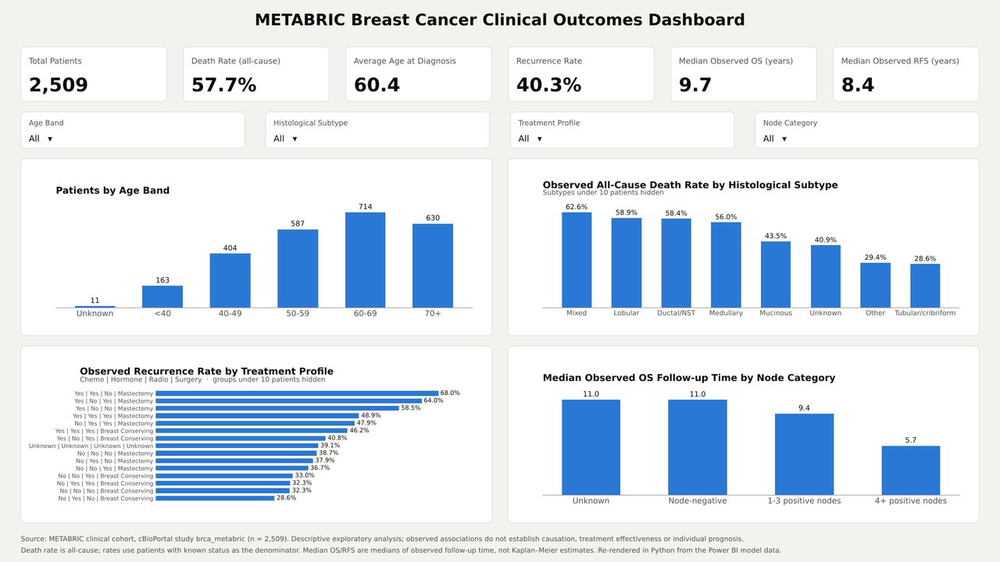
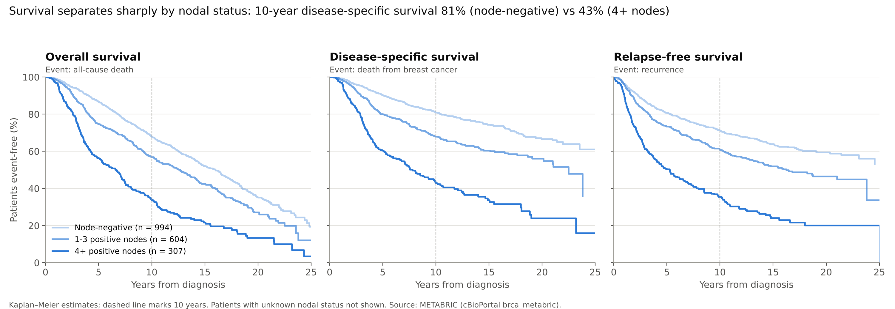

# METABRIC Breast Cancer Clinical Outcomes: Power BI Dashboard and Survival Analysis

A star-schema Power BI dashboard of 2,509 patients from the METABRIC breast cancer cohort, checked against a reproducible survival analysis in Python.



**Read the paper:** [PDF](paper/METABRIC_Clinical_Outcomes_Paper.pdf) · [Word](paper/METABRIC_Clinical_Outcomes_Paper.docx)

**Try the interactive dashboard:** [index.html](index.html). Once the repository is public and GitHub Pages is switched on, it runs at `https://abuhurairahkhan1997-wq.github.io/metabric-powerbi-analysis/`.

## What this project asks

> Which patient, tumour and treatment characteristics are associated with overall survival and recurrence in the METABRIC cohort?

The analysis is descriptive and exploratory. It does not establish causation, treatment effectiveness or individual prognosis.

## Key findings

| Finding | Evidence |
| --- | --- |
| Nodal status is the strongest correlate of outcome | Recurrence rose from 31.9% (node-negative) to 42.3% (1–3 nodes) and 65.8% (4+ nodes). Trend p < 0.001. Ten-year disease-specific survival was 80.9% vs 43.4%. |
| The age pattern in death is driven by other causes | All-cause death rose from 39.5% (40–49) to 78.9% (70+). Death from breast cancer stayed between 31% and 34% from age 40 upwards. |
| A spreadsheet-style median understates survival | MEDIAN() of follow-up time gave 11.0 years for node-negative patients. The Kaplan–Meier median overall survival was 16.0 years. |
| Treatment comparisons reflect who was treated | Chemotherapy patients recurred more (53.9% vs 37.1%). They were also younger, more often ER-negative (65.8% vs 10.7%) and more often had 4+ positive nodes (30.8% vs 11.5%). This is confounding by indication. |



## Repository contents

| Path | What it is |
| --- | --- |
| `powerbi/METABRIC_Clinical_PowerBI_Analysis.pbix` | Power BI file: Power Query cleaning, star schema (1 fact table, 7 dimensions), 10 DAX measures, one-page dashboard |
| `index.html` | Interactive web version of the dashboard. Filters, rates and Kaplan–Meier medians are recalculated in the browser |
| `analysis/extract_data.py` | Pulls the patient-level fact table out of the PBIX into `data/` |
| `analysis/survival_analysis.py` | Wilson CIs, Cochran–Armitage trend tests, Kaplan–Meier, log-rank, Cox models |
| `analysis/paper_figures.py` | Figures 2–4 |
| `analysis/dashboard_render.py` | Static dashboard image and the animated GIF |
| `paper/` | The full paper (PDF and Word), its Markdown source and the build script |
| `data/METABRIC_Clinical_PowerBI_Star_Schema.xlsx` | Source workbook: raw data preserved, cleaned data, star-schema tables, transformation log and data dictionary |
| `figures/` | All figures used in the paper and this README |

## Data model

- **Fact table:** `Fact_Clinical_Outcomes`, with one row per patient.
- **Dimensions:** age band, histological subtype, treatment profile, nodal category, cohort, claudin subtype and integrative cluster.
- **Relationships:** all one-to-many, with single-direction filtering.
- **Slicers and axes:** all use dimension fields.

### DAX measures

| Measure | DAX |
| --- | --- |
| Total Patients | `DISTINCTCOUNT(Fact_Clinical_Outcomes[PATIENT_ID])` |
| Death Rate (all-cause) | `DIVIDE([Total Deaths], [Known OS Patients], 0)` |
| Recurrence Rate | `DIVIDE([Total Recurrences], [Known RFS Patients], 0)` |
| Average Age at Diagnosis | `AVERAGE(Fact_Clinical_Outcomes[AGE_AT_DIAGNOSIS])` |
| Median Observed OS / RFS | `MEDIAN(Fact_Clinical_Outcomes[OS_YEARS])` (this is follow-up time, not survival; see the findings above) |

## Reproduce the analysis

```bash
pip install -r requirements.txt
python analysis/extract_data.py
python analysis/survival_analysis.py
python analysis/paper_figures.py
python analysis/dashboard_render.py
```

To refresh the Power BI model on your own machine, point it at `data/METABRIC_Clinical_PowerBI_Star_Schema.xlsx` under **Transform data → Data source settings**.

## Data source

METABRIC clinical data from [cBioPortal, study brca_metabric](https://www.cbioportal.org/study/summary?id=brca_metabric). The data are de-identified and publicly available. Please cite the original METABRIC publications (Curtis et al., *Nature* 2012; Pereira et al., *Nature Communications* 2016) and cBioPortal (Cerami et al., *Cancer Discovery* 2012; Gao et al., *Science Signaling* 2013) if you reuse them.

## How to cite

Rahman, P.A.H. (2026) *Clinicopathological associations with survival and recurrence in the METABRIC breast cancer cohort: a reproducible descriptive analysis using a Power BI star-schema dashboard*. GitHub. Available at: https://github.com/abuhurairahkhan1997-wq/metabric-powerbi-analysis.

## Author

Pathan Abu Hurairah Rahman · PG Program in Data Analytics & Gen AI
[LinkedIn](https://www.linkedin.com/in/pathan-abuhurairah-rahman-1997-khan) · [GitHub](https://github.com/abuhurairahkhan1997-wq)

The analysis and write-up were carried out with help from an AI assistant (Claude, Anthropic). All results were checked against the underlying data.
