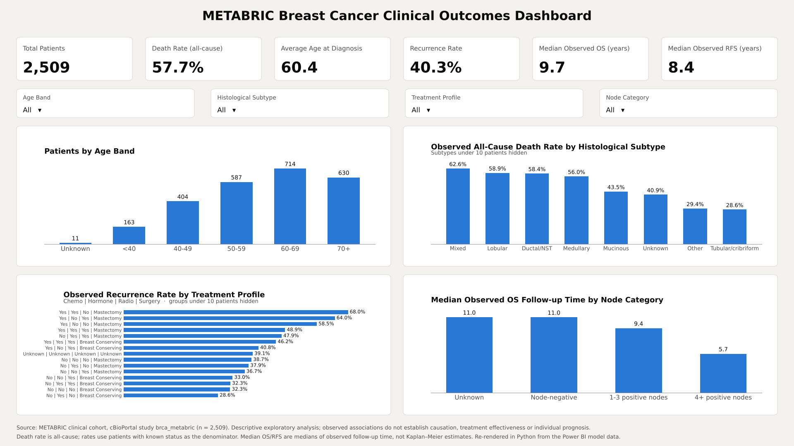
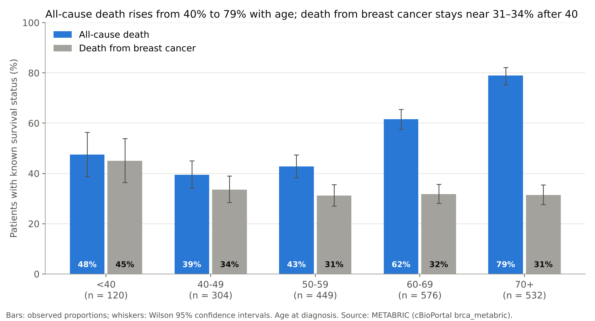
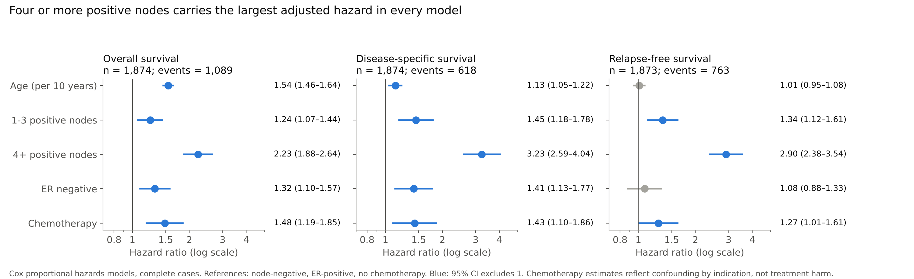

# Clinicopathological Associations with Survival and Recurrence in the METABRIC Breast Cancer Cohort: A Reproducible Descriptive Analysis Using a Power BI Star-Schema Dashboard

Pathan Abu Hurairah Rahman

PG Program in Data Analytics &amp; Gen AI (batch PGDA 0526)

October 2026 · Article type: descriptive cohort analysis and methods note

## Abstract

**Background.** Business-intelligence (BI) tools such as Microsoft Power BI are increasingly used to explore clinical datasets, yet their default aggregations are rarely checked against established survival methods. We built an interactive dashboard of the METABRIC breast cancer cohort and examined which patient, tumour and treatment characteristics were associated with survival and recurrence, and whether dashboard-style summaries agree with conventional time-to-event estimates.

**Methods.** Clinical data for 2,509 patients (cBioPortal study brca_metabric) were cleaned in Power Query and modelled as a star schema with one fact table and seven dimensions. Ten DAX measures summarised cohort size, all-cause death, recurrence, age and follow-up. Findings were then re-estimated in Python using Wilson 95% confidence intervals, Cochran–Armitage tests for trend, Kaplan–Meier estimation, log-rank tests and multivariable Cox proportional hazards models.

**Results.** Survival status was known for 1,981 patients (1,144 deaths: 646 from breast cancer, 497 from other causes) and recurrence status for 2,488 (1,002 recurrences); median follow-up was 16.3 years. Recurrence rose with nodal involvement, from 31.9% in node-negative disease to 65.8% with four or more positive nodes (trend p < 0.001), and ten-year disease-specific survival fell from 80.9% to 43.4%. All-cause death rose from 39.5% at 40–49 years to 78.9% at 70 years and over, whereas death from breast cancer stayed between 31% and 34% across those bands. The dashboard's median of observed follow-up time understated Kaplan–Meier median overall survival by up to five years. Chemotherapy recipients had more recurrence (53.9% vs 37.1%) but were younger and far more often ER-negative and heavily node-positive.

**Conclusions.** Nodal status was the dominant prognostic factor in this cohort. Two analytical lessons generalise beyond METABRIC: all-cause mortality must be separated from cause-specific mortality before age patterns are interpreted, and BI medians of follow-up time should not be reported as survival. Associations with treatment reflect who was treated, not whether treatment worked.

**Keywords:** breast cancer; METABRIC; Power BI; star schema; Kaplan–Meier; lymph node status; confounding by indication; data visualisation

**What this study adds**

- In METABRIC, a dashboard's plain median of survival time understated Kaplan–Meier median overall survival by up to five years (11.0 vs 16.0 years in node-negative disease). The error is easy to make and hard to spot on a finished dashboard.
- The steep rise in all-cause death with age (39.5% to 78.9%) almost disappears when only deaths from breast cancer are counted (31–34% from age 40 upwards).
- A fully reproducible pipeline, from raw clinical file to Power BI star schema to verified survival statistics, that others can reuse for clinical dashboards.

## 1. Introduction

Breast cancer outcomes vary widely between patients, and much of that variation was understood long before the genomic era. Axillary lymph node involvement, tumour size, grade and hormone-receptor status have shaped prognosis and treatment decisions for decades (Carter, Allen and Henson, 1989; Galea et al., 1992). Large, well-annotated cohorts remain the main way of checking how these factors behave in real populations followed over long periods.

The Molecular Taxonomy of Breast Cancer International Consortium (METABRIC) is one such cohort. Its first report profiled roughly 2,000 primary tumours and proposed ten integrative genomic subgroups (Curtis et al., 2012). Later work added targeted sequencing of 2,433 tumours (Pereira et al., 2016) and modelled the timing of relapse over two decades of follow-up (Rueda et al., 2019). The clinical annotations are openly available through cBioPortal (Cerami et al., 2012), which has made METABRIC a common teaching and benchmarking dataset.

That openness brings a less discussed risk. Clinical data are now often explored in general-purpose BI software rather than statistical packages. These tools make it easy to slice a cohort and display rates, averages and medians, but their default aggregations know nothing about censoring, competing causes of death or the reasons a patient received a treatment. A dashboard can look authoritative while quietly answering a different question from the one its title asks.

This paper has two aims. The first is substantive: to describe which patient, tumour and treatment characteristics were associated with overall survival and recurrence in the METABRIC clinical cohort. The second is methodological: to compare the summaries produced by a carefully built Power BI star-schema dashboard with conventional survival estimates, and to set out where the two diverge. We do not claim new biology. The contribution is a transparent, reproducible worked example of how dashboard summaries of clinical outcome data should be specified, labelled and checked.

The analytical question was: *which patient, tumour and treatment characteristics are associated with overall survival and recurrence outcomes in the METABRIC cohort?* All analyses are descriptive and exploratory. They do not establish causation, treatment effectiveness or individual prognosis.

## 2. Methods

### 2.1 Data source

De-identified clinical data for 2,509 female patients were taken from the METABRIC study as distributed by cBioPortal (study identifier brca_metabric; cBioPortal, n.d.; Cerami et al., 2012; Gao et al., 2013). The source table held 24 clinical fields per patient, including age at diagnosis, positive lymph node count, histological subtype, oestrogen-receptor (ER) status by immunohistochemistry, treatment received (chemotherapy, hormone therapy, radiotherapy, type of breast surgery), overall survival (OS) time and status, relapse-free survival (RFS) time and status, and vital status. Vital status distinguishes death from breast cancer from death from other causes. No new data were collected and no attempt was made to re-identify patients.

### 2.2 Data preparation

The raw worksheet was preserved unchanged and imported into Power Query, where every transformation is recorded as a visible applied step. One staging query typed the columns; a second, cleaning query then:

1. corrected a spelling error in ER status ("Positve" to "Positive");
2. standardised the capitalisation of treatment and claudin-subtype labels;
3. converted OS and RFS times from months to years;
4. derived age bands (<40, 40–49, 50–59, 60–69, 70+) and nodal categories (node-negative, 1–3 positive nodes, 4+ positive nodes), labelling missing values "Unknown" rather than imputing them;
5. derived binary event flags for death and recurrence, plus separate flags marking whether each outcome was known;
6. built a composite treatment-profile key in the fixed order chemotherapy | hormone therapy | radiotherapy | surgery.

A dedicated query confirmed that every patient identifier was unique. Checks found no leading or trailing spaces, no duplicate rows and no implausible values (age 21.9–96.3 years; follow-up 0–389 months). Missing outcomes were never coded as zero. A patient with unknown survival status contributes to neither the numerator nor the denominator of the death rate.

### 2.3 Data model

The cleaned query fed one fact table, Fact_Clinical_Outcomes (one row per patient), and seven dimension tables created by reference: age band, histological subtype, treatment profile, nodal category, cohort, claudin subtype and integrative cluster. All seven relationships were one-to-many, with single-direction filtering from dimension to fact and no many-to-many or ambiguous paths. Dimension sort columns kept age bands and nodal categories in clinical order. Every slicer and chart axis drew on dimension fields, not on duplicated fact columns.

### 2.4 Dashboard measures

Ten DAX measures were defined (Table 1). Rates use DIVIDE so that an empty selection returns zero rather than an error.

**Table 1. DAX measures used in the dashboard**

| Measure | Definition (DAX) | Format |
| --- | --- | --- |
| Total Patients | DISTINCTCOUNT(PATIENT_ID) | Whole number |
| Known OS Patients | SUM(OS_KNOWN_FLAG) | Whole number |
| Total Deaths | SUM(DEATH_FLAG) | Whole number |
| Death Rate (all-cause) | DIVIDE([Total Deaths], [Known OS Patients], 0) | 0.0% |
| Known RFS Patients | SUM(RFS_KNOWN_FLAG) | Whole number |
| Total Recurrences | SUM(RECURRENCE_FLAG) | Whole number |
| Recurrence Rate | DIVIDE([Total Recurrences], [Known RFS Patients], 0) | 0.0% |
| Average Age at Diagnosis | AVERAGE(AGE_AT_DIAGNOSIS) | 0.0 |
| Median Observed OS (years) | MEDIAN(OS_YEARS) | 0.0 |
| Median Observed RFS (years) | MEDIAN(RFS_YEARS) | 0.0 |

The two median measures take the median of observed follow-up time across all patients, whether or not they had the event. They are therefore labelled "observed follow-up" on the dashboard and are compared with Kaplan–Meier medians in Section 3.6.

The single-page dashboard holds six KPI cards, four slicers (age band, histological subtype, treatment profile, nodal category) and four charts. Bar charts of rates hide groups of fewer than ten patients, and this is stated on each chart. Tooltips show both the total patients and the number with known outcome status.

### 2.5 Statistical analysis

The patient-level fact table was extracted from the saved Power BI model and analysed in Python 3.13 with pandas, SciPy and statsmodels (Seabold and Perktold, 2010). Proportions are reported with Wilson score 95% confidence intervals (Wilson, 1927). Trends in recurrence and death across ordered nodal categories were tested with the Cochran–Armitage test (Armitage, 1955), and differences across age bands with Pearson's chi-squared test.

Three time-to-event outcomes were analysed:

- overall survival, with death from any cause as the event;
- disease-specific survival, with death from breast cancer as the event and deaths from other causes censored;
- relapse-free survival, with recurrence as the event.

Survival curves were estimated by the Kaplan–Meier method (Kaplan and Meier, 1958) and compared with the log-rank test. Median follow-up was estimated with the reverse Kaplan–Meier method (Schemper and Smith, 1996). Multivariable Cox proportional hazards models (Cox, 1972) included age (per ten years), nodal category, ER status and chemotherapy, using complete cases and Efron's method for ties. Because treatment was not randomised, chemotherapy coefficients were interpreted as markers of the patients selected for treatment, not as treatment effects (Salas, Hofman and Stricker, 1999). Two-sided p-values below 0.05 were regarded as statistically significant. Given the number of comparisons, they are read as descriptive rather than confirmatory.

## 3. Results

### 3.1 Cohort

The cohort comprised 2,509 women with a median age at diagnosis of 61.1 years (interquartile range 50.9–70.0). Just under half were node-negative, and nearly three-quarters had ER-positive tumours (Table 2). Survival status was available for 1,981 patients (79.0%). Among them, 1,144 had died: 646 from breast cancer, 497 from other causes and one with cause unrecorded. Recurrence status was available for 2,488 patients (99.2%), of whom 1,002 had recurred. Median follow-up was 16.3 years. Treatment details were missing for 529 patients (21.1%), almost entirely the same patients who lacked survival data.

**Table 2. Characteristics of the cohort (n = 2,509)**

| Characteristic | n | % |
| --- | --- | --- |
| **Age at diagnosis** | | |
| <40 years | 163 | 6.5 |
| 40–49 years | 404 | 16.1 |
| 50–59 years | 587 | 23.4 |
| 60–69 years | 714 | 28.5 |
| 70 years and over | 630 | 25.1 |
| Unknown | 11 | 0.4 |
| **Nodal status** | | |
| Node-negative | 1,196 | 47.7 |
| 1–3 positive nodes | 695 | 27.7 |
| 4+ positive nodes | 352 | 14.0 |
| Unknown | 266 | 10.6 |
| **ER status (IHC)** | | |
| Positive | 1,817 | 72.4 |
| Negative | 609 | 24.3 |
| Unknown | 83 | 3.3 |
| **Histological subtype** | | |
| Ductal/NST | 1,810 | 72.1 |
| Mixed | 269 | 10.7 |
| Lobular | 192 | 7.7 |
| Other named subtypes¹ | 103 | 4.1 |
| Unknown | 135 | 5.4 |
| **Treatment received²** | | |
| Chemotherapy | 412 | 16.4 |
| Hormone therapy | 1,216 | 48.5 |
| Radiotherapy | 1,173 | 46.8 |
| Mastectomy | 1,170 | 46.6 |
| Breast-conserving surgery | 785 | 31.3 |

¹ Medullary 32, mucinous 25, tubular/cribriform 23, other 21, metaplastic 2. ² Not mutually exclusive; treatment unknown for 529 patients (554 for surgery type).

### 3.2 The dashboard

Figure 1 shows the dashboard with all slicers cleared. Across the whole cohort the all-cause death rate was 57.7% (1,144 of 1,981), the recurrence rate 40.3% (1,002 of 2,488) and the mean age at diagnosis 60.4 years. Each value was reproduced exactly by independent calculation from the model data.

<b>Figure 1.</b> The METABRIC clinical outcomes dashboard with all slicers cleared. The page shows six KPI cards, four slicers and four charts. Groups of fewer than ten patients are hidden from the rate charts. The image is a Python re-rendering of the Power BI page, drawn from the same model data.

### 3.3 Nodal status

Nodal involvement showed the clearest gradient in the cohort (Table 3; Figure 2). Recurrence rose from 31.9% in node-negative disease to 42.3% with one to three positive nodes and 65.8% with four or more (Cochran–Armitage z = 11.1, p < 0.001). All-cause death followed the same order (z = 7.2, p < 0.001). The curves separated early and stayed apart for all three outcomes (log-rank p < 0.001 for each). By ten years, 80.9% of node-negative patients were alive without dying of breast cancer, compared with 43.4% of those with four or more positive nodes.

**Table 3. Outcomes by nodal status**

| Nodal status | Recurrence, % (95% CI) | All-cause death, % (95% CI) | 10-year DSS, % | KM median OS, years (95% CI) | Dashboard median, years |
| --- | --- | --- | --- | --- | --- |
| Node-negative | 31.9 (29.3–34.6); n = 1,182 | 51.7 (48.6–54.8); n = 994 | 80.9 | 16.0 (14.5–17.0) | 11.0 |
| 1–3 positive nodes | 42.3 (38.7–46.0); n = 695 | 59.4 (55.5–63.3); n = 604 | 67.9 | 12.7 (10.7–14.1) | 9.4 |
| 4+ positive nodes | 65.8 (60.7–70.6); n = 351 | 75.2 (70.1–79.7); n = 307 | 43.4 | 6.7 (5.2–7.4) | 5.7 |
| Unknown | 38.5 (32.8–44.5); n = 260 | 52.6 (41.6–63.5); n = 76 | 77.3 | 15.9 (11.0–17.0) | 11.0 |

n = patients with known status for that outcome. DSS = disease-specific survival; KM = Kaplan–Meier; OS = overall survival.

<b>Figure 2.</b> Kaplan–Meier curves for overall, disease-specific and relapse-free survival by nodal status. Darker lines indicate greater nodal involvement.

### 3.4 Age and cause of death

All-cause death rose steeply with age, from 39.5% at 40–49 years to 78.9% at 70 years and over (chi-squared p < 0.001). Death from breast cancer did not follow this pattern (Figure 3). From age 40 upwards it stayed between 31.2% and 33.6%, and differences across all five age bands were of borderline significance (p = 0.05). The rise in all-cause death with age was therefore almost entirely made up of deaths from other causes. The youngest women were the exception: those diagnosed before 40 had the highest disease-specific death (45.0%; 95% CI 36.4–53.9) and the highest recurrence (51.5%; 43.9–59.1).

<b>Figure 3.</b> All-cause death and death from breast cancer by age at diagnosis, among patients with known survival status.

### 3.5 Histological subtype

Ductal/NST, lobular, mixed and medullary tumours had similar recurrence rates (39.8–43.8%). Mucinous (20.0%; n = 25) and tubular/cribriform tumours (17.4%; n = 23) had markedly lower recurrence. Only one of 21 tubular/cribriform patients with known survival status died of breast cancer. These groups are small and their confidence intervals wide (for example 7.0–37.1% for tubular/cribriform recurrence), so the estimates are imprecise even though the direction is consistent. The two metaplastic tumours were excluded from charted rates.

### 3.6 Dashboard medians compared with Kaplan–Meier estimates

The dashboard's median measures understated survival (Table 3). For node-negative patients the median of observed OS time was 11.0 years, against a Kaplan–Meier median of 16.0 years. For one to three positive nodes the figures were 9.4 and 12.7 years. The gap arises because patients still alive at last contact contribute their follow-up time as if it were a survival time. The measure is a summary of how long patients were observed, not how long they lived. The difference narrows where events are frequent and follow-up complete (5.7 vs 6.7 years with four or more positive nodes). Across the whole cohort the dashboard showed 9.7 years, against a Kaplan–Meier median overall survival of 13.0 years.

### 3.7 Treatment and confounding by indication

Patients who received chemotherapy had more recurrence than those who did not (53.9% vs 37.1%). Read at face value, the dashboard's treatment chart could suggest that chemotherapy was harmful. The chemotherapy group was, however, very different at baseline:

- mean age 50.5 vs 63.9 years;
- ER-negative 65.8% vs 10.7%;
- four or more positive nodes 30.8% vs 11.5%.

Within each nodal category the difference shrank (Table 4) but did not disappear, because nodal status is only one of several reasons for offering chemotherapy.

**Table 4. Recurrence by chemotherapy within nodal categories**

| Nodal status | No chemotherapy, % (n) | Chemotherapy, % (n) |
| --- | --- | --- |
| Node-negative | 31.1 (938) | 40.7 (54) |
| 1–3 positive nodes | 40.6 (389) | 45.6 (215) |
| 4+ positive nodes | 61.7 (180) | 70.9 (127) |

The multivariable Cox models (Figure 4) placed four or more positive nodes as the strongest factor for every outcome. The hazard ratios were 2.23 (95% CI 1.88–2.64) for overall survival, 3.23 (2.59–4.04) for disease-specific survival and 2.90 (2.38–3.54) for relapse-free survival. Age was strongly associated with overall survival (HR 1.54 per ten years) but only weakly with disease-specific survival (1.13) and not with recurrence (1.01; 0.95–1.08), which agrees with Section 3.4. ER-negative status was associated with poorer overall and disease-specific survival but not with recurrence over the full follow-up period. Chemotherapy kept a hazard ratio above one after adjustment (RFS 1.27; 1.01–1.61). This is the expected signature of residual confounding by indication: tumour size, grade and HER2 status were not in the model, and all of them influence treatment choice.

<b>Figure 4.</b> Adjusted hazard ratios from Cox proportional hazards models (complete cases). Reference categories: node-negative, ER-positive, no chemotherapy.

## 4. Discussion

### 4.1 Principal findings

Nodal status was the factor most strongly associated with every outcome in this cohort. Its gradient was visible in a simple bar chart and held up in survival analysis and multivariable models. This agrees with the long-standing place of axillary nodes in staging (Carter, Allen and Henson, 1989) and in the Nottingham Prognostic Index (Galea et al., 1992). The dashboard is useful here because a non-specialist can see the gradient in seconds and check it against patient counts in the tooltips.

The age findings needed more care. A dashboard showing all-cause death by age band suggests that older women do far worse. Splitting deaths by cause shows something different: beyond age 40, the risk of dying from breast cancer was roughly constant, and the excess in older women came from deaths from other causes over a long follow-up. Young women diagnosed before 40 stood out with the highest disease-specific mortality and recurrence. This pattern is widely reported and is usually linked to more aggressive tumour biology at younger ages. Mortality by age in a long-follow-up cohort should not be read without the cause of death.

The low recurrence in mucinous and tubular/cribriform tumours is consistent with their reputation as favourable special types. The numbers here are too small to add precision, so we report the pattern and do not rank subtypes.

### 4.2 What the dashboard got wrong, and why it matters

Two dashboard measures that looked reasonable turned out to answer a different question from the one their names implied.

The first was the median of observed survival time. Power BI's MEDIAN function, like any spreadsheet median, treats a patient last seen alive at eight years as if they had died at eight years. In a cohort where many patients were still alive at last contact, this understated median overall survival by up to five years. The correct estimate needs a method that handles censoring, such as Kaplan–Meier. Few BI tools offer this natively. Our solution was to relabel the measure honestly as observed follow-up and to report survival from a separate analysis. A stricter alternative is to remove the measure altogether.

The second was the treatment chart. Grouping recurrence by treatment profile showed the highest recurrence among patients who received chemotherapy. Taken at face value this is backwards. These patients were younger, much more often ER-negative and more heavily node-positive, which is why they were offered chemotherapy. Stratifying by nodal status reduced the gap, and a Cox model reduced it further, but neither removed it: the variables that drive treatment choice were not all recorded. This is confounding by indication (Salas, Hofman and Stricker, 1999), and it cannot be fixed by better visual design. The only safe course in a descriptive dashboard is to label such charts as observed associations and to state plainly that they do not measure treatment effectiveness.

Neither problem is specific to METABRIC or to Power BI. Both arise whenever outcome data with censoring or non-random treatment are summarised by aggregation alone. We suggest three habits for anyone building clinical dashboards:

1. name each measure for what it calculates, not for what one hopes it shows;
2. carry the denominator (patients with known status) into every tooltip;
3. check at least the headline figures against a proper statistical analysis before publishing.

### 4.3 Strengths and limitations

The work has several strengths. The cohort is large and publicly available, follow-up is long, and every transformation from raw file to chart is recorded and repeatable. The star-schema design keeps filtering behaviour predictable, and every dashboard figure was reproduced independently.

The limitations are substantial and should frame any reading of the results.

- **Missing data.** Survival and treatment data were missing for about a fifth of the cohort (528 patients), almost always together. Analyses used complete cases, which could bias results if these patients differed systematically.
- **Missing covariates.** Tumour size, grade, HER2 status and the date of diagnosis were not included. Their absence limits adjustment and explains much of the residual treatment association.
- **Competing risks.** Disease-specific survival was estimated by censoring deaths from other causes. This estimates the cause-specific hazard, not the cumulative probability of dying from breast cancer in the presence of other risks.
- **Proportional hazards.** We did not test this assumption formally. Some effects, particularly of ER status, are known to change over time in METABRIC (Rueda et al., 2019). The Cox estimates are therefore averages over a long period.
- **Era of treatment.** Patients were treated with the protocols of their time, which differ from current practice. Results should not be applied to individual patients today.

### 4.4 Future work

Natural extensions include adding tumour size, grade and HER2 status from the full METABRIC release, and estimating cumulative incidence of breast cancer death in a competing-risks framework. Embedding Kaplan–Meier estimates in the dashboard through a Python or R visual would retire the observed-follow-up medians. Linking the integrative clusters already present in the model (Curtis et al., 2012; Rueda et al., 2019) would connect these clinical patterns to the genomic subgroups for which METABRIC is best known.

## 5. Conclusion

In the METABRIC clinical cohort, nodal involvement was the dominant observed correlate of recurrence and death. The apparent worsening of outcomes with age was largely explained by deaths from other causes. A well-built Power BI star schema reproduced the cohort's descriptive figures exactly and made these patterns easy to explore. Two of its default-style measures, however, would have misled a reader had they not been checked: medians of follow-up presented as survival, and treatment comparisons that reflect who was treated. Dashboards of clinical outcome data are most trustworthy when every measure is named for what it computes and the headline figures are verified against established survival methods.

### Data availability

The METABRIC clinical data are publicly available from cBioPortal (study brca_metabric, https://www.cbioportal.org/study/summary?id=brca_metabric). No new data were generated.

### Code availability

The Power BI file, Power Query steps, DAX measures and the Python analysis scripts are available in the author's GitHub repository (https://github.com/abuhurairahkhan1997-wq/metabric-powerbi-analysis).

### Use of AI tools

An AI assistant (Claude, Anthropic) was used to audit the Power BI model, run the statistical analyses in Python and draft the manuscript text under the author's direction. The author reviewed the analyses and text and takes responsibility for the content.

### Acknowledgements

The author thanks the METABRIC consortium and the patients who contributed to it, and the cBioPortal team for making the data openly available.

## References

Armitage, P. (1955) 'Tests for linear trends in proportions and frequencies', *Biometrics*, 11(3), pp. 375–386. Available at: https://doi.org/10.2307/3001775.

Carter, C.L., Allen, C. and Henson, D.E. (1989) 'Relation of tumor size, lymph node status, and survival in 24,740 breast cancer cases', *Cancer*, 63(1), pp. 181–187. Available at: https://doi.org/10.1002/1097-0142(19890101)63:1&lt;181::AID-CNCR2820630129&gt;3.0.CO;2-H.

cBioPortal for Cancer Genomics (n.d.) *Breast cancer (METABRIC, Nature 2012 & Nat Commun 2016): study brca_metabric* [Dataset]. Available at: https://www.cbioportal.org/study/summary?id=brca_metabric (Accessed: 11 October 2026).

Cerami, E. et al. (2012) 'The cBio cancer genomics portal: an open platform for exploring multidimensional cancer genomics data', *Cancer Discovery*, 2(5), pp. 401–404. Available at: https://doi.org/10.1158/2159-8290.CD-12-0095.

Cox, D.R. (1972) 'Regression models and life-tables', *Journal of the Royal Statistical Society: Series B (Methodological)*, 34(2), pp. 187–220. Available at: https://doi.org/10.1111/j.2517-6161.1972.tb00899.x.

Curtis, C. et al. (2012) 'The genomic and transcriptomic architecture of 2,000 breast tumours reveals novel subgroups', *Nature*, 486(7403), pp. 346–352. Available at: https://doi.org/10.1038/nature10983.

Galea, M.H. et al. (1992) 'The Nottingham Prognostic Index in primary breast cancer', *Breast Cancer Research and Treatment*, 22(3), pp. 207–219. Available at: https://doi.org/10.1007/BF01840834.

Gao, J. et al. (2013) 'Integrative analysis of complex cancer genomics and clinical profiles using the cBioPortal', *Science Signaling*, 6(269), p. pl1. Available at: https://doi.org/10.1126/scisignal.2004088.

Kaplan, E.L. and Meier, P. (1958) 'Nonparametric estimation from incomplete observations', *Journal of the American Statistical Association*, 53(282), pp. 457–481. Available at: https://doi.org/10.1080/01621459.1958.10501452.

Pereira, B. et al. (2016) 'The somatic mutation profiles of 2,433 breast cancers refines their genomic and transcriptomic landscapes', *Nature Communications*, 7, article 11479. Available at: https://doi.org/10.1038/ncomms11479.

Rueda, O.M. et al. (2019) 'Dynamics of breast-cancer relapse reveal late-recurring ER-positive genomic subgroups', *Nature*, 567(7748), pp. 399–404. Available at: https://doi.org/10.1038/s41586-019-1007-8.

Salas, M., Hofman, A. and Stricker, B.H. (1999) 'Confounding by indication: an example of variation in the use of epidemiologic terminology', *American Journal of Epidemiology*, 149(11), pp. 981–983.

Schemper, M. and Smith, T.L. (1996) 'A note on quantifying follow-up in studies of failure time', *Controlled Clinical Trials*, 17(4), pp. 343–346.

Seabold, S. and Perktold, J. (2010) 'Statsmodels: econometric and statistical modeling with Python', in *Proceedings of the 9th Python in Science Conference*. Austin, TX: SciPy, pp. 92–96. Available at: https://doi.org/10.25080/Majora-92bf1922-011.

Wilson, E.B. (1927) 'Probable inference, the law of succession, and statistical inference', *Journal of the American Statistical Association*, 22(158), pp. 209–212. Available at: https://doi.org/10.1080/01621459.1927.10502953.

